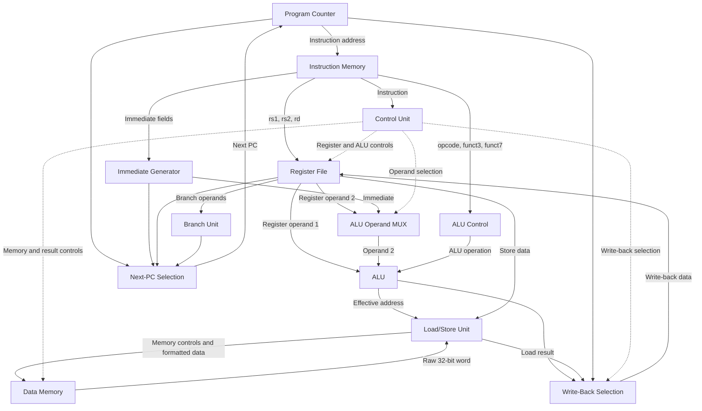
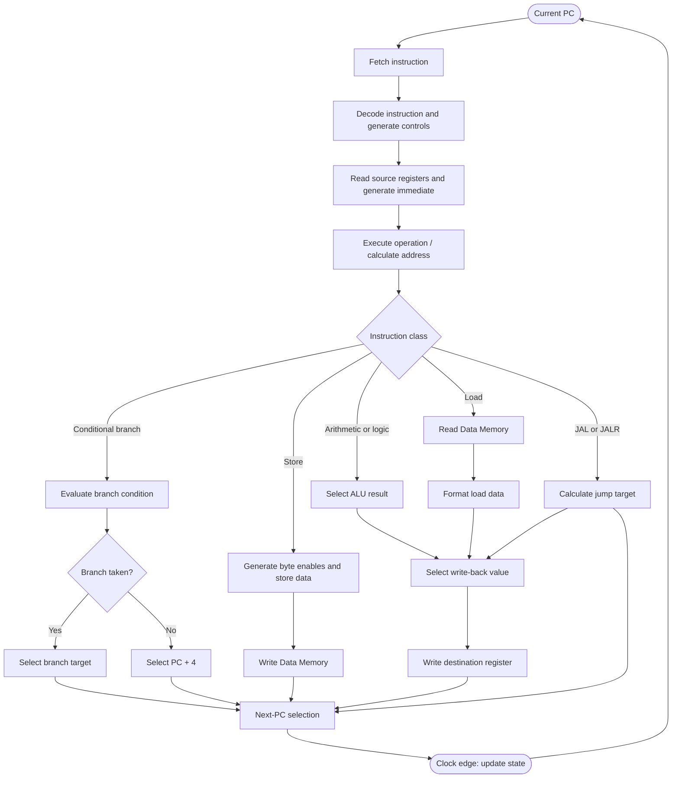

# Single-Cycle RISC-V Processor (RV32I)

A 32-bit RISC-V processor implemented in **SystemVerilog using AMD Xilinx Vivado 2022.2**. This project demonstrates processor datapath design, instruction decoding, arithmetic and logical execution, branching, memory access, and register write-back through a modular single-cycle architecture.

The design is organized into independent hardware modules to make the internal working of a processor easier to understand and extend.


## Table of Contents

- [Project Overview](#project-overview)
- [Features](#features)
- [Repository Structure](#repository-structure)
- [Overall Architecture](#overall-architecture)
- [How Modules Are Connected](#how-modules-are-connected)
- [Instruction Execution Flowchart](#instruction-execution-flowchart)
- [Worked Example 1: ADDI](#worked-example-1-addi)
- [Worked Example 2: LW](#worked-example-2-lw)
- [Worked Example 3: SB](#worked-example-3-sb)
- [Module Responsibilities](#module-responsibilities)
- [Instruction Classes](#instruction-classes)
- [Design Decisions](#design-decisions)
- [Future Improvements](#future-improvements)
- [Tools and Technologies](#tools-and-technologies)

## Project Overview

A single-cycle processor completes each supported instruction within one clock cycle. Its datapath contains the hardware needed to fetch an instruction, decode it, obtain operands, execute an operation, access memory if required, and update architectural state.

For an arithmetic instruction, the result usually comes from the Arithmetic Logic Unit (ALU). For a load instruction, the result comes from data memory. For a jump instruction, the processor also calculates the return address and selects a new program counter.

The control unit coordinates these operations by generating the control signals needed by the datapath.

## Features

- 32-bit RISC-V datapath.
- Program Counter (PC) and instruction memory.
- Register file containing `x0`–`x31`, with `x0` hardwired to zero.
- Immediate generation for I-, S-, B-, U-, and J-type instructions.
- ALU arithmetic, logical, shift, and comparison operations.
- Conditional branch evaluation using signed and unsigned comparisons.
- `JAL` and `JALR` jump support.
- Byte-enabled data memory.
- Byte, halfword, and word load/store handling.
- Sign extension for signed loads and zero extension for unsigned loads.
- Instruction initialization through `program.hex`.

## Repository Structure

```text
Single-Cycle-RISC-V-Processor/
├── rtl/
│   ├── top_single_cycle.sv
│   ├── prog_cntr.sv
│   ├── instr_mem.sv
│   ├── reg_file.sv
│   ├── imm_generation.sv
│   ├── alu.sv
│   ├── alu_cntrl.sv
│   ├── control_unit.sv
│   ├── branch_unit.sv
│   ├── load_store_unit.sv
│   └── data_mem.sv
├── testbench/
│   └── tb_top_single_cycle.sv
├── docs/
│   └── architecture.png
├── program.hex
├── README.md
├── LICENSE
└── .gitignore
```

The tree above illustrates the intended organization. Keep the filenames and folder names consistent with the files actually committed to the repository.

## Overall Architecture

The processor is composed of two interacting parts:

- **Datapath:** transports and processes instruction data through the register file, immediate generator, ALU, and memory.
- **Control path:** decodes the instruction and determines which operations, data sources, memory actions, and write-back choices are required.

### High-level block diagram



The diagram illustrates the major data and control paths. The exact signal connections are defined in `top_single_cycle.sv`.

## How Modules Are Connected

The top-level module, `top_single_cycle.sv`, connects the processor components.

| Module | Inputs come from | Outputs go to |
|---|---|---|
| `prog_cntr.sv` | Clock, reset, next-PC logic | Instruction memory and PC-related logic |
| `instr_mem.sv` | PC | Control unit, register file address fields, immediate generator, ALU control |
| `control_unit.sv` | Instruction opcode | Register write, ALU source, memory controls, immediate type, result selection, branch/jump controls |
| `reg_file.sv` | Instruction register fields and write-back data | ALU, branch unit, load/store unit |
| `imm_generation.sv` | Instruction and immediate type | ALU operand selection and next-PC logic |
| `alu_cntrl.sv` | Opcode and function fields | ALU operation selection |
| `alu.sv` | Register operand, selected second operand, ALU operation | Arithmetic result and effective address |
| `branch_unit.sv` | Register operands and `funct3` | Branch decision |
| `load_store_unit.sv` | Load/store controls, address offset, store data, raw memory data | Byte enables, formatted store data, load result, access validity |
| `data_mem.sv` | Address, write data, read/write controls, byte enables | Raw 32-bit memory read data |
| `top_single_cycle.sv` | All connected module outputs and control signals | PC update and architectural write-back |

### Important signal connections

**Program counter and instruction fetch**

The current PC is sent to instruction memory. The fetched instruction is decoded into fields such as `opcode`, `rd`, `rs1`, `rs2`, `funct3`, and `funct7`.

**Register file and immediate generator**

The register file provides source operands. The immediate generator reconstructs the constant or offset encoded in the instruction.

**ALU and branch unit**

The ALU performs arithmetic, logic, shifts, comparisons, and effective-address calculations. The branch unit separately compares the two register operands and determines whether a conditional branch is taken.

**Load/store unit and data memory**

The ALU calculates the effective memory address. The load/store unit derives the byte offset, selects the access width, generates byte enables for stores, and formats loaded data. Data memory reads or updates the containing 32-bit word.

**Write-back and next PC**

The write-back logic selects the ALU result, load result, or `PC + 4`. `LUI` and `AUIPC` use their special result paths. Separately, next-PC logic chooses the sequential PC, branch target, `JAL` target, or `JALR` target.

## Instruction Execution Flowchart


This is a conceptual execution flow. The actual datapath performs many of these steps combinationally in parallel during the same cycle, rather than executing each box as a separate clock cycle.

## Worked Example 1: ADDI

### Instruction

```asm
ADDI x5, x6, 10
```

Meaning:

```text
x5 = x6 + 10
```

Assume `x6 = 20`.

| Step | What happens | Value |
|---|---|---|
| Fetch | Instruction memory supplies `ADDI` | Instruction fetched |
| Decode | Control unit identifies an immediate arithmetic instruction | `ALU_SRC = 1`, register write enabled |
| Register read | Register file reads `x6` | 20 |
| Immediate generation | Immediate generator extracts the signed immediate | 10 |
| Execute | ALU adds its operands | 30 |
| Write-back | ALU result is selected | `x5 = 30` |
| PC update | Sequential address is selected | `PC + 4` |

The memory is not accessed by this instruction.

## Worked Example 2: LW

### Instruction

```asm
LW x7, 4(x6)
```

Assume:

```text
x6 = 128
Memory word at byte address 132 = 0x12345678
```

The effective address is:

```text
128 + 4 = 132
```

The address is aligned, and the memory word index is:

```text
132 / 4 = 33
```

The instruction follows this path:

1. The register file supplies `x6 = 128`.
2. The immediate generator produces `4`.
3. The ALU calculates address `132`.
4. Data memory returns the word at index 33.
5. The load/store unit selects the word for `LW`.
6. The write-back multiplexer selects the loaded data.
7. Register `x7` is updated to `0x12345678` at the clock edge.

## Worked Example 3: SB

### Instruction

```asm
SB x5, 1(x6)
```

Assume:

```text
x6 = 128
x5 = 0x000000AA
Memory word before store = 0x11223344
```

The effective byte address is `129`. The word index is `129 >> 2 = 32`, and the byte offset is `1`.

For a little-endian word, the initial byte arrangement is:

| Address | Byte |
|---:|---:|
| 128 | `44` |
| 129 | `33` |
| 130 | `22` |
| 131 | `11` |

The load/store unit enables byte lane 1 and formats the low byte of `x5` for storage. At the clock edge, only the selected lane changes:

| Address | Byte after store |
|---:|---:|
| 128 | `44` |
| 129 | `AA` |
| 130 | `22` |
| 131 | `11` |

The resulting word is:

```text
0x1122AA44
```

This example shows how `byte_enable` lets the processor update one byte without overwriting the other three bytes.

## Module Responsibilities

| Module | Responsibility |
|---|---|
| `top_single_cycle.sv` | Connects the full datapath and control path |
| `prog_cntr.sv` | Stores the current PC and updates it on the clock edge |
| `instr_mem.sv` | Reads instructions initialized from `program.hex` |
| `reg_file.sv` | Stores registers and protects `x0` |
| `imm_generation.sv` | Reconstructs instruction immediates |
| `control_unit.sv` | Generates instruction-level control signals |
| `alu_cntrl.sv` | Decodes the operation to perform in the ALU |
| `alu.sv` | Performs arithmetic, logical, shift, comparison, and address calculations |
| `branch_unit.sv` | Evaluates branch conditions |
| `load_store_unit.sv` | Selects data widths, generates byte enables, and extends load values |
| `data_mem.sv` | Stores data words and returns the containing word on reads |

## Instruction Classes

The implementation is designed around these RV32I instruction classes:

| Category | Examples |
|---|---|
| Arithmetic | `ADD`, `SUB`, `ADDI` |
| Logical | `AND`, `OR`, `XOR`, `ANDI`, `ORI`, `XORI` |
| Shifts | `SLL`, `SRL`, `SRA`, `SLLI`, `SRLI`, `SRAI` |
| Comparisons | `SLT`, `SLTU`, `SLTI`, `SLTIU` |
| Loads | `LB`, `LBU`, `LH`, `LHU`, `LW` |
| Stores | `SB`, `SH`, `SW` |
| Branches | `BEQ`, `BNE`, `BLT`, `BGE`, `BLTU`, `BGEU` |
| Jumps | `JAL`, `JALR` |
| Upper immediates | `LUI`, `AUIPC` |

This table lists intended instruction coverage, not a claim of complete RISC-V specification compliance. Individual instruction encodings, edge cases, invalid accesses, and alignment behavior should be assessed separately.

## Design Decisions

- The processor uses a 32-bit datapath and a register file containing 32 integer registers.
- The register file provides combinational reads and clocked writes.
- Instruction memory is initialized using `$readmemh`.
- Data memory provides combinational reads and clocked byte-enabled writes.
- The load/store unit handles signed and unsigned loads and supported alignment rules.
- The PC logic handles sequential execution, conditional branches, `JAL`, and `JALR`.
- Exception handling and broader architectural compliance remain potential areas for improvement.
- FPGA synthesis, timing, and resource utilization are separate from functional simulation.

## Future Improvements

- Expand instruction-level regression and corner-case coverage.
- Improve invalid-access and exception handling.
- Add assertions and automated regression summaries.
- Evaluate synthesis timing and FPGA resource usage.
- Extend the design to a five-stage pipeline: IF, ID, EX, MEM, and WB.
- Implement hazard detection, forwarding, and pipeline control.

## Tools and Technologies

- **Hardware description language:** SystemVerilog
- **FPGA design environment:** AMD Xilinx Vivado 2022.2
- **Architecture:** Single-cycle, 32-bit RISC-V
- **Instruction initialization:** `$readmemh` and `program.hex`
 
